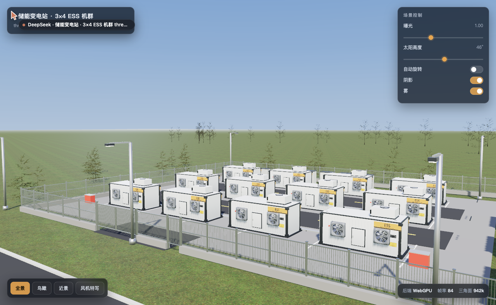

# 储能变电站 · WebGPU / three.js 实时渲染

用 **three.js r186 的 WebGPURenderer** 在浏览器里实时渲染一座 3×4 储能（ESS）集装箱变电站：
12 台 2.5 MWh 储能箱、24 台带金属保护罩的轴流散热风机、箱变 / 主变 / 中控室 / 配电箱 / 稳压器、围栏与道路，以及草坪、树线、渐变天空。

> 场景来自 Blender 建模（93.9 万三角面 → Draco 压缩后 23.8 MB），导出 glTF 2.0 后由 three.js 加载。
> 在线预览：**https://littleboyck.github.io/ess-substation-web3d/**



## 功能

- **WebGPU 后端**（自动回退 WebGL2），右下角实时显示后端 / 帧率 / 三角面数
- 四个预设机位：全景 / 鸟瞰 / 近景 / 风机特写，相机 lerp 缓动切换
- 控制面板：曝光、太阳高度（实时移动光源 + 太阳光晕）、自动旋转、阴影、雾
- 鼠标拖拽旋转、滚轮缩放（OrbitControls）
- 过程化环境光照（`PMREMGenerator` 生成 equirect HDR），金属件才有正确反射
- TSL 做旧涂装材质：按世界坐标 Y 从地面往上做污渍渐变
- 1500 m 远景地面 + 雾，地平线平滑淡入天空

## 本地运行

浏览器不允许 `file://` 直接加载 ES module 与 .glb，需要起一个本地静态服务。

```bash
node server.mjs          # 默认 http://127.0.0.1:8765/
node server.mjs 3000     # 指定端口
```

`server.mjs` 只用 Node 内置模块（http / fs / path），无任何依赖，支持 Range 请求与正确的 MIME（`.glb` / `.wasm`）。

## 目录

```
index.html                 页面骨架 + HUD + importmap
main.js                    全部渲染逻辑
server.mjs                 本地静态服务（Node，无依赖）
model/ess-substation.glb   Draco 压缩 + 1K 贴图，23.8 MB
vendor/three/              three.js r186 构建 + 用到的 addons + Draco 解码器
```

`vendor/three/` 只保留了实际用到的部分：`three.webgpu.js` / `three.core.js` / `three.tsl.js`、
`GLTFLoader` / `DRACOLoader` / `OrbitControls` / `BufferGeometryUtils` / `SkeletonUtils`、以及 Draco wasm 解码器，
所以页面**不依赖任何 CDN**（three.js 为 MIT 许可，见 `vendor/three/LICENSE`）。

## 实现备注

- **WebGPU 的金属件**：没有 IBL 时 metallic 材质会渲染成纯黑，所以用 Canvas 画一张 512×256 equirect（天空 / 地面 / 太阳光斑）→ `PMREMGenerator.fromEquirectangular` → `scene.environment`（强度 0.85）。
- **天空**：Canvas 渐变贴图贴在半径 2600 的球**内壁**（BackSide、`fog:false`、`toneMapped:false`），比 TSL 天空在 WebGPU 下更稳定；太阳用加性混合的 Sprite 跟随「太阳高度」。
- **树叶**：`*sapling* / *twig* / *branch*` 材质统一 `alphaTest = 0.42, transparent = false, side = DoubleSide`，否则 WebGPU 下叶片会被裁掉。
- **取景中心**：不能用整块 1800 m 草坪的包围盒，改用 `储能单元_R2C2` 的世界坐标当站心。
- **模型压缩**：`gltf-transform resize --width 1024` + Blender 导出时开 Draco（量化 14/10/12），56.7 MB → 23.8 MB。

## 许可

代码 MIT。模型与贴图仅作演示用途（部分植被贴图/模型来自 Poly Haven，CC0）。
